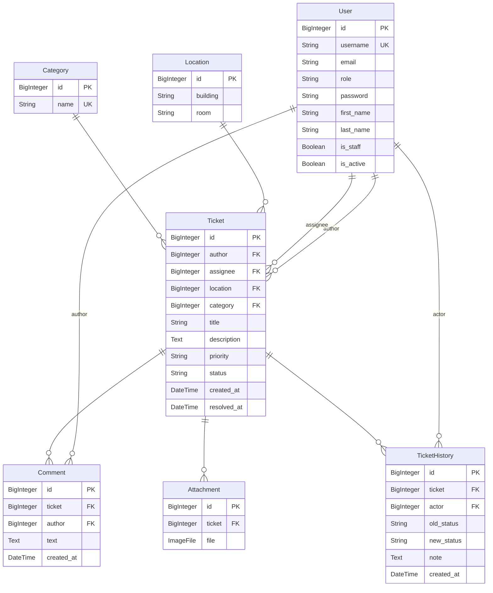

# ER-диаграмма FixDesk

## Обоснование отклонений от предложенной модели

Модель полностью соответствует требованиям ТЗ. Отклонений нет:

1. **User** - кастомная модель с полем `role`, наследуется от AbstractUser
2. **Location** - уникальность на (building, room) реализована через unique_together
3. **Category** - уникальность на name
4. **Ticket** - все поля согласно ТЗ, индексы на FK и полях фильтров
5. **Attachment** - связь с Ticket, валидация на максимум 3 файла через signal
6. **Comment** - связь с Ticket и User
7. **TicketHistory** - связь с Ticket и User, on_delete=PROTECT для защиты истории

Все индексы добавлены на FK, поля фильтров и сортировки как указано в ТЗ.
